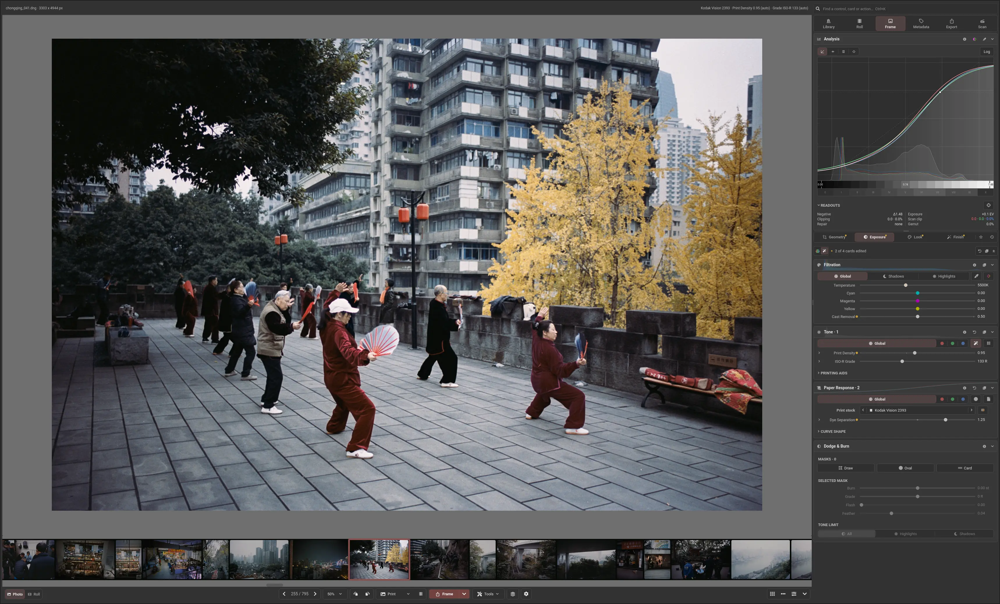

<div align="center">
  <h1>NegPy</h1>

  [](https://github.com/marcinz606/NegPy/actions/workflows/ci.yml)
  [](https://github.com/marcinz606/NegPy/releases)
  [](LICENSE)
  [](negpy/translations/USER_GUIDE.it.md)

  **[English](README.md) · Italiano**
</div>

NegPy trasforma le scansioni di negativi e diapositive in immagini finite. L'autore l'ha scritto perché voleva uno strumento pensato per le scansioni di pellicola che facesse più che invertirle. Modella la pellicola e la carta fotografica, e aggiunge le comodità di uno scanner da laboratorio. Funziona su Linux, macOS e Windows.



La [Guida utente](negpy/translations/USER_GUIDE.it.md) descrive ogni pannello e controllo (la ⓘ di ogni pannello la apre dentro il programma). [PIPELINE.md](docs/it/PIPELINE.md) spiega la matematica.

## Lingue

L'interfaccia è disponibile in inglese, cinese semplificato (简体中文), giapponese (日本語), coreano (한국어), tedesco (Deutsch), vietnamita (Tiếng Việt), norvegese bokmål (Norsk bokmål) e **italiano**. Le guide dei pannelli sono tradotte in tutte le lingue tranne il vietnamita. Scegli la lingua in **Preferenze → Interfaccia → Lingua**, poi riavvia NegPy. **Predefinita di sistema** segue la lingua del sistema e usa l'inglese per le lingue non supportate. Le guide dei pannelli mancanti ricadono sull'inglese. Vedi [Contribuire](docs/it/CONTRIBUTING.md#traduzioni) per aggiornare o aggiungere una traduzione.

La traduzione italiana copre tutta l'interfaccia, i messaggi, la visita guidata, la guida utente e la documentazione in [docs/it](docs/it).

## Funzionalità

### Conversione

* La maschera arancione viene rimossa in base alla sensitometria di ciascun canale: niente profili della fotocamera, niente prelievo del colore del bordo.
* La stampa viene costruita nello spazio delle densità su una curva H&D (piede, tratto rettilineo, spalla) e graduata in punti ISO-R come la carta da camera oscura.
* Densità automatica e Gradazione automatica misurano ogni fotogramma rispetto a obiettivi regolabili.
* Profili di carta ricavati dalle schede tecniche di Ilford, Kodak, Foma e Fuji.
* Modalità negativo a colori, B/N e diapositiva. Le diapositive si aprono così come acquisite, con Densità e Gradazione automatiche facoltative per la pellicola sbiadita e la fusione HDR di esposizioni a forcella.

### Rullini

* La libreria è un elenco di rullini: cartelle importate, oppure rullini virtuali composti da fotogrammi qualsiasi.
* Valori predefiniti per tutto il rullino per modalità pellicola, ritaglio, calibrazione, misurazione, decodifica RAW, obiettivo e metadati, con eccezioni per singolo fotogramma.
* L'Analisi del rullino dà a ogni fotogramma di un rullino, o di una scena al suo interno, lo stesso riferimento.
* Smistamento tieni/scarta, divisione dei mezzi formati, unione, e ricerca per metadati o (su richiesta) per contenuto.

### Acquisizione

* Scanner per pellicola: Plustek OpticFilm 8200i SE, 8100 V2, 8300i SE, 7600i v1 e 7600i v2 via USB, Nikon Coolscan, Reflecta, Pacific Image e tutto ciò che SANE supporta.
* Scansione con fotocamera collegata (macOS e Linux), comprese le acquisizioni RGB a banda stretta con uno [Scanlight](https://github.com/jackw01/scanlight) e la fusione tricromica al sottopixel ([guida](docs/it/CAMERA_SCANNING.md)).
* Correzione del campo piatto, calibrazione del sensore per la luce a banda stretta e correzione dell'obiettivo letta dal file.
* RAW di fotocamera, TIFF, DNG, JPEG XL e formati di scanner come Pakon, NEF di Coolscan, FFF di Flextight e Noritsu.

### Modifica

* Schermatura e bruciatura con maschere poligonali, ovali e a bordo di cartoncino, ciascuna con intensità, sfumatura, gradazione di contrasto e limite tonale propri.
* Rimozione di polvere, peli e graffi: automatica, dal canale IR o a pennello, conservando la grana della pellicola.
* Strumenti da camera oscura: strisce di prova, ventaglio di prove colore, scala di grigi a gradini, sovrapposizione delle zone, densitometro a punto e collocazione delle zone.
* Maschera di contrasto, basculaggio e brandeggio, bruciatura dei bordi, portanegativi limato e passe-partout di stampa.
* Lith, cianotipia e viraggi per il B/N.
* Resa sulla GPU tramite wgpu (Vulkan, Metal o DX12), e un percorso CPU multicore in Rust che dà lo stesso risultato.

### Uscita

* Gestione del colore ICC, rilevamento del profilo del monitor e prova a video.
* Esportazione in JPEG, TIFF, PNG, WebP e JPEG XL, con bordi, preimpostazioni, provini a contatto e [modelli dei nomi file](docs/it/TEMPLATING.md).
* Un master TIFF piatto a 16 bit per altri programmi di modifica, oppure un'esportazione lineare che salta la pipeline.
* Metadati dell'attrezzatura e della ripresa scritti in EXIF e XMP.

### I tuoi dati

* Non distruttivo: i file sorgente non vengono mai modificati.
* Le modifiche stanno in un database SQLite locale indicizzato per contenuto del file, quindi i file si possono spostare. File collaterali `.negpy` facoltativi stanno accanto alle scansioni.
* La cronologia di annullamento e le stampe di lavoro con nome sopravvivono a un riavvio.
* Le [scorciatoie da tastiera](docs/it/KEYBOARD.md) si possono riassegnare.

## Per iniziare

Il modo consigliato è eseguire NegPy dal codice sorgente: ricevi ogni correzione appena arriva su `main`, e il sistema non mostra avvisi per un'app non firmata. La guida [Contribuire](docs/it/CONTRIBUTING.md#configurazione-per-lo-sviluppo) contiene i passaggi: installa `uv` e `rustup`, poi esegui `make install` e `make run`.

Puoi anche scaricare la versione per il tuo sistema dalla [pagina delle versioni](https://github.com/marcinz606/NegPy/releases). Quando esce una nuova versione, compare un punto sul menu ⋯, e **Aggiorna alla vX.Y.Z…** nel suo menu Aiuto la installa. Le versioni non sono firmate, quindi aspettati un avviso al primo avvio.

### Linux

Rendi eseguibile l'`.AppImage` con `chmod +x` e avviala.

Facoltativo, per SANE e la scansione con fotocamera:
```
sudo apt install libsane        # Debian/Ubuntu
sudo pacman -S sane libgphoto2  # Arch
```

### Nix

```bash
nix run github:marcinz606/NegPy
```
Oppure aggiungilo come input di un flake:
```nix
{
  inputs.negpy.url = "github:marcinz606/NegPy";
  outputs = { self, nixpkgs, negpy, ... }: {
    # negpy.packages.<system>.default
  };
}
```

### macOS

1. Apri il `.dmg` e trascina NegPy in `/Applications`.
2. Esegui `xattr -cr /Applications/NegPy.app` nel Terminale.
3. Avvialo.

Facoltativo, per SANE e la scansione con fotocamera ([Homebrew](https://brew.sh/)):
```
brew install sane-backends libgphoto2
```

Per compilare il DMG, imposta `NEGPY_MACOS_ARCH=x86_64` (Intel) o `NEGPY_MACOS_ARCH=arm64` (Apple Silicon).

### Windows

Esegui il programma di installazione superando gli avvisi.

Gli scanner Plustek OpticFilm richiedono il driver WinUSB, installato con [Zadig](https://zadig.akeo.ie/) al posto del driver di SilverFast. Vedi [PLUSTEK_WINDOWS.md](docs/it/PLUSTEK_WINDOWS.md). La scansione con fotocamera non è disponibile su Windows.

## Dove stanno i dati

Tutto si trova in `Documents/NegPy`. Su Windows, se quella cartella è bloccata, NegPy ne chiede un'altra e suggerisce Local AppData. `NEGPY_USER_DIR` ha la precedenza su entrambe.

* `edits.db`: le tue modifiche.
* `settings.db`: le impostazioni dell'app.
* `cache/`: miniature. Si può eliminare senza problemi.
* `export/`: cartella di esportazione predefinita.
* `icc/`: profili di carte e stampanti.
* `override.toml`: sostituzioni all'avvio (vedi sotto).

## Risoluzione dei problemi

Se NegPy si arresta all'avvio o mostra immagini errate, modifica `override.toml` (scritto al primo avvio). La maggior parte dei valori di `[performance]` si trova anche nelle Preferenze (`Ctrl + ,`), ma il file prevale.

```toml
[rendering]
# Opzioni: "auto", "vulkan" (Linux/Win), "dx12" (Win), "metal" (macOS), "cpu"
backend = "vulkan"

[display]
# Backend del grafo di scena di Qt. Opzioni: "auto", "vulkan", "d3d12", "metal", "opengl", "software"
qt_rhi_backend = "auto"

# Plugin del sistema di finestre (solo Linux). Opzioni: "auto", "xcb", "wayland"
qt_platform = "auto"

[performance]
# Limita in pixel la dimensione delle texture GPU, utile sulle schede con poca VRAM. "auto" = nessun limite.
max_texture_size = "auto"

# Forza l'anteprima HQ attiva/disattiva. Togli il commento per sostituire la preferenza salvata.
# force_hq_preview = false

# Lato lungo dell'anteprima interattiva in pixel (512-8192). Più alto dà un'area di
# lavoro più nitida e più VRAM per fotogramma.
# preview_render_size = 1600

# Dimensione della cache delle anteprime: tiene in memoria le foto viste di recente per una navigazione istantanea.
# Abbassa questi valori sui computer con poca RAM. Togli il commento per sostituire i predefiniti (~1,2 GB / 8 foto).
# preview_cache_max_bytes = 1200000000
# preview_cache_max_entries = 8

[logging]
# "debug", "info", "warning", "error"
level = "info"
```

`backend = "cpu"` disattiva la resa sulla GPU se il backend GPU si arresta.

## Altro

* [Piano di sviluppo](docs/it/ROADMAP.md)
* [Registro delle modifiche](docs/CHANGELOG.md) (in inglese)
* [Contribuire](docs/it/CONTRIBUTING.md)

## Licenza

[GPL-3](LICENSE).

## Sostegno

Se NegPy ti piace, offri all'autore un rullino, così ha più dati di prova :)

[](https://ko-fi.com/marcinzawalski)
