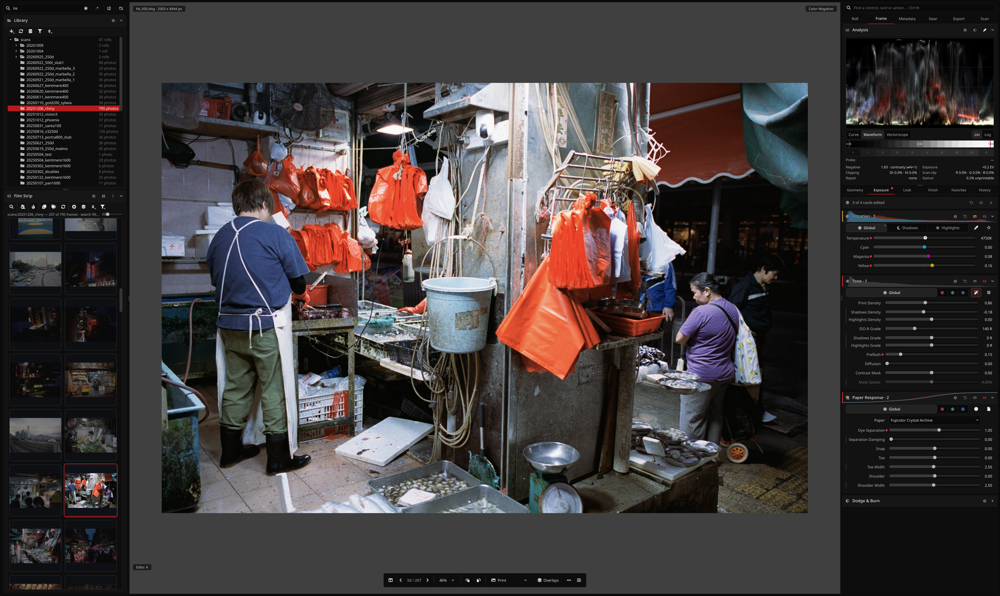

<div align="center">
  <h1>NegPy</h1>

  [](https://github.com/marcinz606/NegPy/actions/workflows/ci.yml)
  [](https://github.com/marcinz606/NegPy/releases)
  [](https://github.com/marcinz606/NegPy/releases)
  [](LICENSE)
  [](pyproject.toml)
  [](https://github.com/astral-sh/ruff)
  [](#getting-started)
  [](https://github.com/marcinz606/NegPy/graphs/contributors)
  [](https://discord.gg/JySNzUWgwy)
</div>

NegPy turns scans of film negatives and slides into finished pictures. I wrote it because I wanted a tool made for film scans that does more than invert them. It models film and photographic paper, and adds the conveniences of a lab scanner. It is written in Python and runs on Linux, macOS and Windows.



The [User Guide](docs/USER_GUIDE.md) covers every panel and control (the ⓘ on each panel opens it in the app). [PIPELINE.md](docs/PIPELINE.md) explains the math.

## Languages

The desktop interface and panel guides support English, Simplified Chinese (简体中文), Japanese (日本語) and Korean (한국어). Choose a language in **Preferences → Interface → Language**, then restart NegPy. **System Default** follows your system language and uses English for unsupported languages. Missing panel translations fall back to English. See [CONTRIBUTING.md](CONTRIBUTING.md#translations) to update or add a translation.

## Features

### Conversion

* The orange mask is removed from each channel's own sensitometry: no camera profiles, no border color picking.
* The print is built in density space on an H&D curve (toe, straight section, shoulder) and graded in ISO-R points like darkroom paper.
* Auto Density and Auto Grade meter each frame to adjustable targets.
* Paper profiles from Ilford, Kodak, Foma and Fuji datasheets.
* Color negative, B&W and slide modes. Slides open as captured, with optional normalization for faded film and HDR merging of bracketed exposures.

### Rolls

* The library is a list of rolls: imported folders, or virtual rolls built from any frames.
* Roll-wide defaults for film mode, crop, calibration, metering, raw decode, lens and metadata, with per-frame overrides.
* Roll Analysis gives every frame of a roll, or of a scene within it, the same baseline.
* Keep/reject triage, half-frame splitting, stitching, and search by metadata or (opt-in) content.

### Capture

* Film scanners: Plustek OpticFilm 8200i SE, 8100 V2, 8300i SE and 7600i v1 over USB, Nikon Coolscan, Reflecta, Pacific Image, and anything SANE supports.
* Tethered camera scanning (macOS and Linux), including narrowband RGB captures with a [Scanlight](https://github.com/jackw01/scanlight) and a sub-pixel Trichrome merge ([guide](docs/CAMERA_SCANNING.md)).
* Flat-field correction, sensor calibration for narrowband light, and lens correction read from the file.
* Camera RAWs, TIFF, DNG, JPEG XL and scanner formats such as Pakon, Coolscan NEF, Flextight FFF and Noritsu.

### Editing

* Dodge and burn with polygon, oval and card-edge masks, each with its own strength, feather, contrast grade and tone limit.
* Dust, hair and scratch removal: automatic, from the IR channel (NegPy or OpenICE method), or painted, keeping the film grain.
* Darkroom tools: test strips, ring-around, step wedge, zone overlay, spot densitometer and zone placement.
* Contrast mask, tilt and swing, edge burn, filed carrier and print mats.
* Lith, cyanotype and toners for B&W.
* GPU rendering (Vulkan, Metal or DX12) with a CPU fallback that gives the same result.

### Output

* ICC color management, monitor profile detection and soft proofing.
* Export to JPEG, TIFF, PNG, WebP and JPEG XL, with borders, presets, contact sheets and [filename templates](docs/TEMPLATING.md).
* A flat 16-bit TIFF master for other editors, or a linear export that skips the pipeline.
* Gear and capture metadata written to EXIF and XMP.

### Your data

* Non-destructive: source files are never modified.
* Edits live in a local SQLite database keyed by file content, so files can move. Optional `.negpy` sidecars sit next to the scans.
* Undo history and named work prints survive a restart.
* [Keyboard shortcuts](docs/KEYBOARD.md) can be remapped.

## Getting started

Download the build for your OS from the [Releases page](https://github.com/marcinz606/NegPy/releases). NegPy then updates itself from an Update Available notice.

To build from source, see [CONTRIBUTING.md](CONTRIBUTING.md).

The builds are not signed, so expect a warning on first run.

### Linux

Make the `.AppImage` executable with `chmod +x` and run it.

Optional, for SANE and camera scanning:
```
sudo apt install libsane        # Debian/Ubuntu
sudo pacman -S sane libgphoto2  # Arch
```

### Nix

```bash
nix run github:marcinz606/NegPy
```
Or add it as a flake input:
```nix
{
  inputs.negpy.url = "github:marcinz606/NegPy";
  outputs = { self, nixpkgs, negpy, ... }: {
    # negpy.packages.<system>.default
  };
}
```

### macOS

1. Open the `.dmg` and drag NegPy to `/Applications`.
2. Run `xattr -cr /Applications/NegPy.app` in Terminal.
3. Launch it.

Optional, for SANE and camera scanning ([Homebrew](https://brew.sh/)):
```
brew install sane-backends libgphoto2
```

To build the DMG, set `NEGPY_MACOS_ARCH=x86_64` (Intel) or `NEGPY_MACOS_ARCH=arm64` (Apple Silicon).

### Windows

Run the installer past the warnings.

Plustek OpticFilm scanners need the WinUSB driver, installed with [Zadig](https://zadig.akeo.ie/) in place of the SilverFast driver. See [PLUSTEK_WINDOWS.md](docs/PLUSTEK_WINDOWS.md). Camera scanning is not available on Windows.

## Data location

Everything is in `Documents/NegPy`. On Windows, if that folder is blocked, NegPy asks for another and suggests Local AppData. `NEGPY_USER_DIR` overrides both.

* `edits.db`: your edits.
* `settings.db`: app settings.
* `cache/`: thumbnails. Safe to delete.
* `export/`: default export folder.
* `icc/`: paper and printer profiles.
* `override.toml`: startup overrides (below).

## Troubleshooting

If NegPy crashes on startup or renders wrong, edit `override.toml` (written on first run). Most `[performance]` values are also in Preferences (`Ctrl + ,`), but the file wins.

```toml
[rendering]
# Options: "auto", "vulkan" (Linux/Win), "dx12" (Win), "metal" (macOS), "cpu"
backend = "vulkan"

[display]
# Qt scene-graph backend. Options: "auto", "vulkan", "d3d12", "metal", "opengl", "software"
qt_rhi_backend = "auto"

# Window system plugin (Linux only). Options: "auto", "xcb", "wayland"
qt_platform = "auto"

[performance]
# Cap GPU texture size in pixels — useful on low-VRAM cards. "auto" = no limit.
max_texture_size = "auto"

# Force HQ preview on/off. Uncomment to override saved preference.
# force_hq_preview = false

# Long edge of the interactive preview in pixels (512-8192). Higher is a sharper
# canvas and more VRAM per frame.
# preview_render_size = 1600

# Preview cache size — keeps recently-viewed photos in memory for instant navigation.
# Lower these on low-RAM machines. Uncomment to override defaults (~1.2 GB / 8 photos).
# preview_cache_max_bytes = 1200000000
# preview_cache_max_entries = 8

[logging]
# "debug", "info", "warning", "error"
level = "info"
```

`backend = "cpu"` turns GPU rendering off if the GPU backend crashes.

## More

* [Roadmap](docs/ROADMAP.md)
* [Changelog](docs/CHANGELOG.md)
* [Contributing](CONTRIBUTING.md)

## License

[GPL-3](LICENSE).

## Support

If you like NegPy, buy me a roll of film so I have more test data :)

[](https://ko-fi.com/marcinzawalski)
